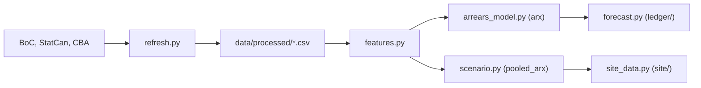

# household-credit-stress

A stress test for Canadian household mortgage debt, built to refresh from public data every week and grade its own arrears forecasts in the open.

## In plain words

Each month this tool reads the mortgage rate, the jobless rate, and how many Canadian
mortgages are behind on payments, one region at a time. It guesses next month's
numbers before the bank group that tracks them does, then checks its own guess once
the real numbers come out, where anyone can see it. The first guesses were made in
October 2026, and none has been checked yet. You can also move sliders for the
rate and job losses to see how arrears might shift over the next two years. That part
is a picture of "what if", not a number to plan around.

## Try it

There is no live link yet. The static page in `site/` runs locally; otherwise these
three commands:

```bash
make setup
make demo
make all
```

`make demo` needs no downloads and no keys.

## Result

The one- and three-month model (`arx`, [ADR 0003](docs/decisions/0003-arrears-model.md))
does not beat the simplest [baseline](docs/glossary.md#baseline) it was built to beat.
Against AR(1), its test-period [mean absolute error](docs/glossary.md#mean-absolute-error)
is worse by 0.03 bp one month ahead and by 0.17 bp three months ahead, and both ranges cover zero: -0.01 to 0.12 bp, and -0.03 to 0.54 bp, at a 95% confidence level. <!-- not-a-claim -->
These are [backtest](docs/glossary.md#backtest) numbers on the latest
[vintage](docs/glossary.md#vintage) of the data, not the numbers a forecaster saw at the
time. See [CLAIMS.md](CLAIMS.md) for where each number comes from.


`arx` sits to the right of AR(1) at both horizons, not to the left, so the chart shows
the same result: more error, not less.

## How I worked

- Evaluation plan, written before any results: [docs/eval_plan.md](docs/eval_plan.md)
  (commit `bc8acfd`).
- Decision records: [docs/decisions/](docs/decisions/).
- Error analysis: the per-region slope instability and the no-clear-difference result
  that led to pooling the drivers for the scenario engine, in
  [0004-scenarios.md](docs/decisions/0004-scenarios.md) ("Context") and
  [docs/whats_weak.md](docs/whats_weak.md).
- How ready it is for production, scored against Breck et al.'s checklist:
  [docs/ml_test_score.md](docs/ml_test_score.md).
- How the AI assistant was used: [AI_USAGE.md](AI_USAGE.md).

## How it works



`refresh.py` checks the three public sources every week (each publishes monthly) and writes the processed CSV
files plus a status file that flags stale data. `features.py`
builds one row per region and month, with every driver lagged to what a forecaster
could have known on that date. `arrears_model.py`'s `arx` equation makes the one- and
three-month ledger forecasts that `forecast.py` appends to
an append-only record. `scenario.py` reuses the same equation, pooled across regions,
to turn a user's rate and unemployment path into an illustrative two-year arrears path.
`site_data.py` exports the numbers both paths need as JSON, and the static page in
`site/` adds them up itself.

## Data notes

This repo pulls from three public sources, each under its own terms.

- Bank of Canada Valet API, source of the posted 5-year mortgage rate. The Bank's
  [Terms of Use](https://www.bankofcanada.ca/terms/) let anyone freely use, copy,
  distribute and transmit its content, provided the Bank of Canada is credited as the
  source and any changes are noted. The Valet API also caps how often it can be
  called; the weekly refresh stays well under that.
- Statistics Canada, source of the unemployment rate. Covered by the
  [Statistics Canada Open Licence](https://www.statcan.gc.ca/en/reference/licence):
  a free, worldwide licence to use, reproduce, publish and redistribute the data,
  commercial or not, as long as Statistics Canada is credited as the source.
- The Canadian Bankers Association's "Mortgages in Arrears" spreadsheet, archived at
  `data/raw/cba/`. The CBA's [Terms of Use](https://cba.ca/article/terms-of-use) let
  anyone use or copy "Information" from its site if it is copied accurately, kept in
  context, and credited to the CBA, and reserve commercial use of that Information to
  CBA members. Neither clause says whether archiving a copy of the published file
  itself, rather than citing numbers from it, counts as permitted copying. This repo
  has archived one file so far under that open question
  (`data/raw/cba/2026-07.xlsx`). See "Needs Iliya" in `_portfolio/STATUS.md`: before
  this repo is public, Iliya should confirm with the CBA or replace the archive with
  numbers only.

## What's weak

The two biggest weaknesses: `arx` does not beat AR(1) at one and three months (see
"Result" above), and the scenario engine's own twelve- and twenty-four-month check
against AR(1) also fails, so every scenario is shown as "Illustrative: not a forecast",
never as a conditional forecast. There is also no live record yet: the repo is not
on GitHub, so the weekly refresh has never run and no ledger forecast is graded. The
full ranked list, including why history before
this repo's own archive is visible only as its latest revision, is in
[docs/whats_weak.md](docs/whats_weak.md).

## Docs

- Tutorial: [docs/tutorial.md](docs/tutorial.md)
- How-to guides: [docs/how-to/](docs/how-to/)
- Reference: [docs/reference.md](docs/reference.md)
- Explanation: [docs/explanation.md](docs/explanation.md)
- Glossary: [docs/glossary.md](docs/glossary.md)
- Model card: [MODEL_CARD.md](MODEL_CARD.md)
- Changes: [CHANGELOG.md](CHANGELOG.md)

## Repo map

<!-- repo-map:start -->
| Path | What it holds |
|---|---|
| `.github/` | CI workflows and GitHub settings |
| `CLAIMS.md` | Every number in the docs, with its source file and command |
| `data/` | Small data files, or scripts that download the data |
| `docs/` | Evaluation plan, decisions, glossary and the four kinds of docs |
| `ledger/` | The append-only live forecast and outcome rows (docs/eval_plan.md) |
| `Makefile` | One command for each step: setup, lint, test, eval, demo |
| `reports/` | Generated results, including metrics.json |
| `site/` | The static page for GitHub Pages and the JSON files `site_data.py` exports for it |
| `src/` | The package code |
| `tests/` | Unit and data tests |
| `tools/` | Checks for claims, readability, AI-writing signs and links |
<!-- repo-map:end -->

## License

MIT. See [LICENSE](LICENSE).
